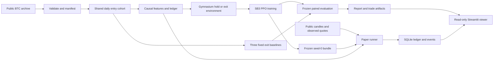

# Architecture

Implemented as one small Python research package, a separate paper process and a read-only local viewer. See README for reproduction commands.

## Responsibilities

| Component | Owns | Boundary |
|---|---|---|
| Data/cohorts | Downloads, checksums, UTC quality, entry eligibility and exclusions | Cannot select entries using exit outcomes |
| Features | Ordered causal observations and frozen scaler | No fitting on validation/test |
| Ledger/environment | Fully funded entry, exit cost, timing, reward and termination | No exchange order endpoints |
| Baselines | Frozen shared-entry exit rules | No per-trade hindsight selection |
| Training | PPO seeds/budget and artifact identities | No UI-triggered fitting or test selection |
| Evaluation/report | Paired outcomes, calendar metrics and complete trial history | No updated model/scaler |
| Paper runner | Daily scheduling, post-decision observed reference, simulated holdings and recovery | No learning or historical fill substitution |
| Viewer | Display verified artifacts and read-only paper snapshots | Cannot train, place trades or mutate state |

The shared ledger prevents inconsistent economics. Independent hand-calculated fixtures challenge mistakes shared by all methods. Historical-open and observed-quote adapters stay separate and labeled.

## Interfaces and storage

The implemented `src/kairos/` package exposes `kairos data`, `kairos train`, `kairos seal`, `kairos evaluate`, `kairos paper` and `kairos ui`. Evaluation writes a report as part of its output; there is no standalone `kairos report` command.

| Artifact | Minimum content |
|---|---|
| Dataset manifest | URLs, retrieval/checksums, range/schema/quality |
| Cohort/split manifest | Gate version, entry/endpoint times, valid/excluded/gated counts, prior-use classification |
| Experiment ledger | Git/config/package/data hashes, every trial/seed/baseline, budget and freeze identity |
| Frozen bundle | Policy, scaler, feature schema, entry and cost contracts |
| Episode outputs | Shared entry ID, timestamps, observed inputs/actions, prices/costs, exit reason, per-method return and hourly equity |
| Paper state | Session/cohort/bundle identity, holdings, cursor, endpoint and atomic event history |
| UI/report bundle | Immutable manifest and small reviewed tables/plots; explicit fixture/development/evaluation/paper mode |

Large data, models, raw runs and local state remain ignored. Commit only reviewed portable reports and permitted small samples later.

## Tools and dependency budget

The package requires Python 3.11 or newer. Its declared dependencies include Gymnasium, Stable-Baselines3/PyTorch, NumPy, pandas, scikit-learn, Streamlit and Plotly; `uv.lock` records the resolved environment. SQLite and hashing use the standard library.

No frontend build toolchain, web API, tracking server, broker service or authentication system is needed for the local viewer. The archive downloader uses system curl with normal TLS verification; reproducibility commands use the committed lock file.

Backtesting.py is an optional independent development cross-check. Freqtrade is a possible later candle-based paper adapter; NautilusTrader offers a later execution integration. Neither is required to learn/test this exit policy, and reconciling a second engine is deferred.

UI state cannot be the source of trading truth. Streamlit reruns must only read data; SQLite single-writer paper state and manifest checks own durable identity.
